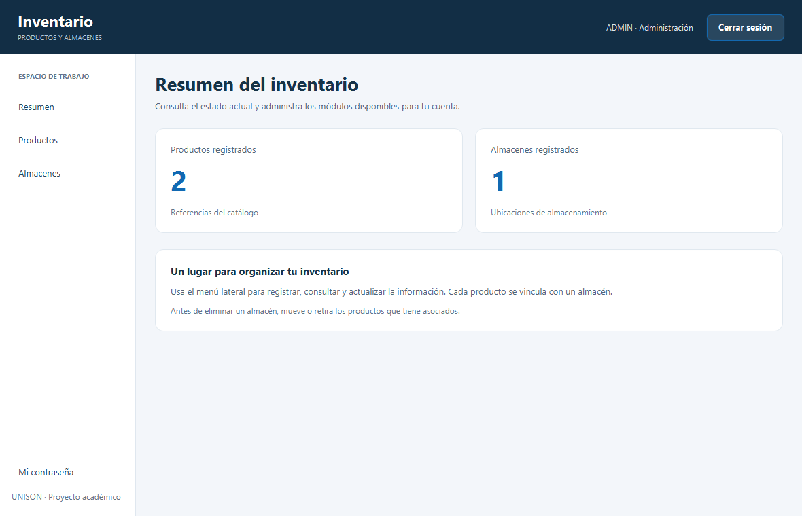
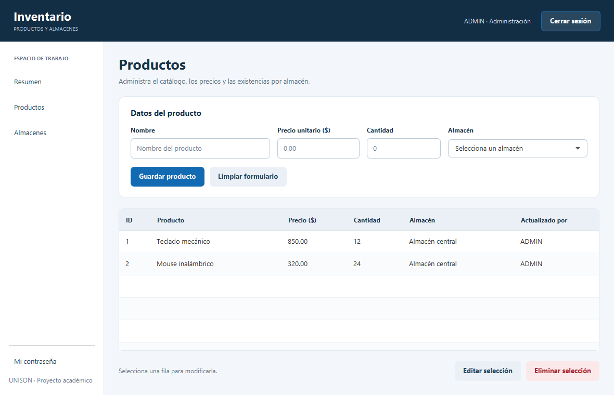

# Sistema de Inventario

Aplicación de escritorio para administrar productos, existencias y almacenes, desarrollada con **Java 21, JavaFX y SQLite**. Los datos se guardan localmente y cada usuario accede a los módulos correspondientes a su rol.

El proyecto nació como una reingeniería académica en la Universidad de Sonora: la versión anterior utilizaba Swing y JDBC; esta versión incorpora vistas FXML, persistencia con ORMLite y pruebas automatizadas.

## Vista previa

Pantallas de la aplicación ejecutada con datos de demostración.





## Funcionalidades

- Crear, consultar, editar y eliminar productos y almacenes.
- Asociar cada producto a un almacén y registrar su precio y existencias.
- Validar los datos antes de guardarlos y confirmar las eliminaciones.
- Evitar la eliminación de almacenes que todavía contienen productos.
- Registrar al usuario que modifica un producto y conservar al creador de cada almacén.
- Consultar los totales de productos y almacenes en el panel de inicio.
- Iniciar y cerrar sesión, con permisos por rol y cambio de contraseña propia.
- Explorar la aplicación mediante un modo de demostración independiente de los datos habituales.

## Tecnologías

| Componente | Tecnología |
| --- | --- |
| Lenguaje y entorno | Java 21 |
| Interfaz | JavaFX 21, FXML y CSS |
| Persistencia | SQLite y ORMLite 6.1 |
| Construcción | Maven |
| Pruebas | JUnit 5 |
| Verificación automatizada | GitHub Actions en Windows y Linux |

## Ejecutar el proyecto

### Requisitos

- **JDK 21**, con `JAVA_HOME` apuntando a su instalación.
- **Maven 3.9 o posterior**, disponible como `mvn`.
- Git para clonar el repositorio.
- Un entorno de escritorio para abrir la interfaz gráfica.

Comprueba el entorno antes de empezar:

```sh
java -version
mvn -version
```

Ambos comandos deben mostrar Java 21. Maven descarga las dependencias, incluido JavaFX; no es necesario instalar un SDK de JavaFX por separado. La primera compilación requiere conexión a Internet.

### Instalación y primer acceso

```sh
git clone https://github.com/Yeudiel123/Inventario-Reingenieria-V2.git
cd Inventario-Reingenieria-V2/InventarioFX_ORM
mvn clean verify
mvn javafx:run
```

Cuando la base de datos está vacía, el formulario permite crear la primera cuenta de administrador. Elige un nombre de usuario y una contraseña propios. En los siguientes accesos se muestra el inicio de sesión habitual.

El usuario admite entre 3 y 40 letras sin acentos, números, puntos, guiones y guiones bajos. Las contraseñas nuevas deben tener entre 12 y 128 caracteres.

El uso normal no crea cuentas con contraseñas predeterminadas. La base de datos local `inventario_v2.db` se genera al iniciar la aplicación.

### Modo de demostración

Desde `InventarioFX_ORM`, ejecuta:

```sh
mvn -Pdemo javafx:run
```

Este modo utiliza `inventario_demo.db` y carga datos de ejemplo y estas cuentas:

La carga ocurre solo cuando no existen cuentas; volver a abrir la demo conserva los cambios que hayas hecho.

| Usuario | Contraseña de demostración | Permisos |
| --- | --- | --- |
| `ADMIN` | `admin123` | Productos y almacenes |
| `USER_PROD` | `prod123` | Productos |
| `USER_ALM` | `alm123` | Almacenes |

Todos los roles pueden cambiar su propia contraseña. Las cuentas anteriores son exclusivamente para explorar la demo; no deben utilizarse con información real.

### Ubicación de los datos

Las rutas predeterminadas son relativas a la carpeta desde la que se inicia la aplicación. Para elegir otro archivo SQLite, pasa la propiedad `inventario.db`:

```sh
mvn "-Dinventario.db=C:/datos/mi-inventario.db" javafx:run
```

Elige una carpeta existente. Cierra la aplicación antes de copiar el archivo de base de datos para hacer un respaldo. `mvn clean` elimina la compilación, pero no elimina las bases de datos.

## Estructura

```text
InventarioFX_ORM/
├── pom.xml
└── src/
    ├── main/
    │   ├── java/mx/unison/
    │   │   ├── controladores/  Eventos de la interfaz
    │   │   ├── datos/          Conexión y acceso a SQLite
    │   │   ├── modelos/        Entidades de ORMLite
    │   │   ├── utileria/       Sesión y contraseñas
    │   │   └── vistas/         Inicio de la aplicación
    │   └── resources/vistas/   FXML y estilos
    └── test/java/              Pruebas automatizadas
```

Las vistas FXML se comunican con sus controladores; estos utilizan los DAO de ORMLite para leer y guardar las entidades. SQLite mantiene los datos en un archivo local, sin un servidor adicional.

## Pruebas y documentación

Ejecuta las verificaciones desde `InventarioFX_ORM`:

```sh
mvn clean verify
```

Las pruebas usan bases de datos temporales o en memoria, sin modificar el inventario local. GitHub Actions ejecuta la misma verificación en Windows y Linux con Java 21. La comprobación automatizada cubre la lógica y la persistencia; la navegación visual requiere una revisión de escritorio.

Para generar la documentación de las clases:

```sh
mvn javadoc:javadoc
```

Abre `InventarioFX_ORM/target/site/apidocs/index.html`. La documentación HTML, los archivos compilados, la configuración del editor y las bases de datos locales se generan en cada equipo y no se versionan.

## Contraseñas y alcance

Las contraseñas nuevas se almacenan mediante PBKDF2 con una sal aleatoria por contraseña. Los hashes de la versión anterior se actualizan cuando el usuario inicia sesión correctamente.

Las bases nuevas incluyen una restricción de SQLite que impide eliminar almacenes con productos. Las bases de versiones anteriores conservan su esquema y sus datos; en ellas, la aplicación comprueba esta relación antes de eliminar un almacén.

La aplicación está orientada al aprendizaje y a la demostración de un inventario de escritorio local. Los permisos se comprueban en las acciones de la aplicación; el archivo SQLite no está cifrado y una persona con acceso directo al equipo puede modificarlo. El proyecto no incluye sincronización entre equipos ni gestión de usuarios desde la interfaz.

## Resolver problemas frecuentes

| Mensaje o situación | Qué revisar |
| --- | --- |
| `mvn` no se reconoce | Instala Maven y añade su carpeta `bin` al `PATH`. |
| `release version 21 not supported` | Revisa `mvn -version` y configura `JAVA_HOME` con un JDK 21. |
| No se abre ninguna ventana | Ejecuta la aplicación en una sesión de escritorio con Java 21. |
| No se puede abrir SQLite | Comprueba que la carpeta existe, tienes permisos de escritura y el archivo no está bloqueado. |

## Autor

[Yeudiel Almada](https://github.com/Yeudiel123) · Proyecto académico de Ingeniería en Sistemas de Información, Universidad de Sonora.
